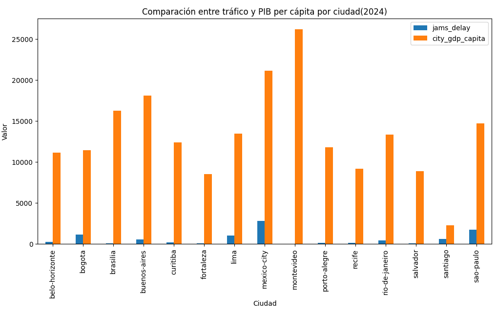

# 🏙️ Movilidad Urbana y Productividad Económica en América Latina (2024)

## 📌 Contexto & Objetivo
Proyecto desarrollado en el marco de una simulación analítica para el **Banco Interamericano de Desarrollo (BID)**. El objetivo central es evaluar la relación entre la movilidad urbana —medida a través de los retrasos por congestión (`jams_delay`)— y la productividad económica —representada por el PIB per cápita (`city_gdp_capita`)— para el año 2024. 

La meta es determinar si el crecimiento económico de las principales áreas metropolitanas está ligado al colapso vial, identificando cuellos de botella de infraestructura que obstaculizan el bienestar y la eficiencia en el desplazamiento diario de la población.

---

## 🛠️ Stack Tecnológico
* **Lenguaje:** Python
* **Librerías:** `pandas`, `numpy`, `seaborn`, `matplotlib`
* **Entorno:** Google Colab / Jupyter Notebook
* **Fuentes de Datos:** 
  1. *TomTom Traffic Index* (Datos de congestión vehicular en tiempo real).
  2. *OECD Cities* (Indicadores de PIB per cápita, desempleo y población urbana).

---

## 🔄 Metodología del Pipeline de Datos
1. **Ingesta y Exploración:** Análisis de estructuras, tipos de datos y detección de valores nulos en ambas fuentes.
2. **Limpieza y Estandarización:** Estandarización de nombres de ciudades, conversión de marcas de tiempo UTC y filtrado estricto para el período anual **2024**.
3. **Agregación por Ciudad-Año:** Reducción de múltiples registros diarios de tráfico a promedios consolidados por ciudad.
4. **Cruce Relacional (`INNER JOIN`):** Integración de los datasets de movilidad y economía asegurando la consistencia de los registros para 15 ciudades clave de América Latina.
5. **Validación Exploratoria:** Uso de histogramas, diagramas de caja (*boxplots*) y gráficos de barras comparativos para detectar distribuciones y *outliers*.

---

## 🧾 Resumen Ejecutivo

### Contexto & Objetivo
El presente análisis evalúa la relación entre la movilidad urbana y la productividad económica para el año 2024 en 15 ciudades de América Latina. El propósito es identificar cuellos de botella en la infraestructura vial que afectan la competitividad y la calidad de vida.

### Hallazgos Iniciales
* **Desacople entre riqueza y tráfico:** Los resultados demuestran que no existe una relación lineal directa entre la riqueza económica y la congestión vehicular. Mientras que ciudades con alto PIB per cápita como Montevideo presentan índices de congestión mínimos, Ciudad de México combina una economía fuerte con niveles críticos de tráfico.
* **Economías intermedias saturadas:** Bogotá, Lima y São Paulo experimentan una alta congestión vehicular con economías de ingresos medios.
* **Concentración de la congestión:** El análisis de distribución mediante *boxplots* reveló una fuerte presencia de *outliers* hacia la derecha en la variable `jams_delay`, indicando que el tráfico pesado está concentrado de forma desproporcionada en urbes específicas.

### 📈 Visualización Clave del Análisis
*Comparativa visual entre el índice de retraso por congestión y el PIB per cápita para las ciudades seleccionadas en 2024.*


*(Gráfico 1: Se observa el desacople entre la economía y la congestión, destacando los casos de Ciudad de México, Bogotá y Lima con alta fricción vial).*

### Conclusión & Cierre del Proyecto
En conclusión, el análisis exploratorio y las visualizaciones generadas permiten demostrar que no existe una relación lineal directa entre el desarrollo económico y el colapso vial en la región. Mientras que la distribución del PIB per cápita concentra a la mayoría de las ciudades analizadas en rangos intermedios con marcadas asimetrías, la comparativa de tráfico revela que urbes como Bogotá, Lima y Ciudad de México enfrentan una fricción vial desproporcionada que contrasta con sus dinámicas productivas. Estos hallazgos reafirman la necesidad de orientar las decisiones de inversión hacia aquellas metrópolis donde los cuellos de botella en la movilidad actúan como un freno directo para la eficiencia económica y la calidad de vida de la ciudadanía.

---

## 📂 Estructura del Repositorio
```text
├── images/                    # Visualizaciones y gráficos del análisis
├── notebook/                  # Jupyter Notebook con el análisis completo (Colab)
└── README.md                  # Documentación del proyecto
